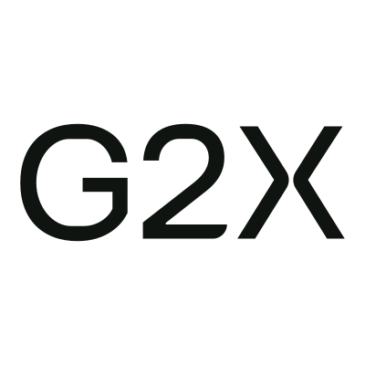

<p align="center">
  
</p>

# GovCon agent skills by G2X

The agentic context layer for GovCon.

This repository holds the G2X agent skills for government contracting and the GovCon MCP listing details: this README, [`server.json`](server.json) (the MCP Registry entry) and the logo. The server is hosted by G2X.

## GovCon MCP by G2X

Search federal opportunities, contract awards, agencies and companies from G2X in Claude, ChatGPT, Cursor or your own agents. Included with every G2X plan, including the free Community Edition.

GovCon MCP brings G2X's federal market intelligence into your AI agents. Search open SAM.gov opportunities with their documents, and look up contract awards, IDVs, agencies, companies, forecasts, labor rates and NSNs. Research a competitor's or incumbent's contracts, find expiring awards and likely recompetes, and find teaming partners by NAICS. With your permission, your agent can also update your G2X watchlist, pipeline and CRM. Every answer comes from your G2X account, follows your plan's permissions and limits, and links back to the source record. GovCon MCP is included with every G2X plan, including the free Community Edition: no time limit and no card required.

### Connect

Server: `https://mcp.g2x.com/mcp` (streamable HTTP; OAuth sign-in with a G2X account)

Add it to your agent as a remote MCP server, then sign in with your G2X account when your agent asks. No API key goes in the configuration.

Cline (`cline_mcp_settings.json`):

```json
{
  "mcpServers": {
    "g2x": {
      "type": "streamableHttp",
      "url": "https://mcp.g2x.com/mcp",
      "disabled": false,
      "autoApprove": []
    }
  }
}
```

To sign in from the terminal, run `cline mcp` and choose Authorize OAuth.

Steps for Claude, ChatGPT, Cursor and other agents: https://g2x.com/docs/connect

### Example prompts

1. Find open Department of Homeland Security opportunities under NAICS 541512 due in the next 60 days, with deadlines and links.
2. Which contracts held by [company UEI] end in the next 12 months, and who are the likely recompete competitors?
3. Which small businesses won VA set-aside awards in NAICS 541512 in FY2025?

### Links

- Website: https://g2x.com/mcp
- Pricing: https://g2x.com/pricing
- Support: https://g2x.com/support
- Privacy: https://g2x.com/privacy-policy

## Who is behind this

G2X is a federal growth intelligence platform built and run by career government contracting growth and execution professionals. Leading government contractors, including GDIT, Booz Allen Hamilton and Leidos, use G2X. Many people know G2X through its intelligence service first; the platform behind it connects that analyst-curated intelligence with opportunity and award research, company and agency records, GovCon CRM, watchlists and pipelines, Bid Hub and Lumen. That is the context this skill puts in front of your AI agent.

## What the skill does

The GovCon MCP skill (version 1.4.0) gives your agent a working knowledge of how pursuit work actually gets done: which G2X tool answers which question, how to read a solicitation completely instead of skimming one page, how to check an incumbent or teaming partner without confusing a corporate family for a single awardee, when a market number is a real total and when it is a sample, and how to save the finished brief or matrix in your G2X account so your team can pick it up.

It covers all 66 GovCon MCP tools: calibration and usage, opportunity search and whole documents, awards and recompetes, companies and teaming, forecasts and events, pipelines and saved searches, GovCon CRM, Bid/No-Bid capture, DLA supply items, labor rates and GSA eBuy. There is one entry point, twelve reference files and nine end-to-end workflows. The agent loads only what the task in front of it needs.

Your agent does the reasoning and drafting with its own model. G2X supplies the records, the documents and the account actions.

## Install the skill

```sh
npx skills add G2X-Team/govcon-agent-skills --skill govcon-mcp
```

The installer asks which agent to target. To install for Claude Code, Codex and Cursor in the current project:

```sh
npx skills add G2X-Team/govcon-agent-skills --skill govcon-mcp --agent claude-code codex cursor
```

Add `--global` to use the skill across all your projects. The Vercel skills installer needs Node.js 22.20 or newer. Choose Claude Code, Codex, Cursor or another supported agent; the [skills CLI documentation](https://skills.sh/docs/cli) covers the options. The skill's listing is at [skills.sh/g2x-team/govcon-agent-skills/govcon-mcp](https://www.skills.sh/g2x-team/govcon-agent-skills/govcon-mcp).

Choose individual workflows:

```sh
npx skills add G2X-Team/govcon-agent-skills --skill govcon-agency-account-plan govcon-incumbent-research govcon-teaming-partners
```

To see every skill in this repository without installing:

```sh
npx skills add G2X-Team/govcon-agent-skills --list
```

## Connect G2X

The skill is instructions. The tools come from the hosted G2X MCP, which you add through your agent's normal remote MCP settings:

```text
https://mcp.g2x.com/mcp
```

For research with no account changes, connect to the read-only research endpoint instead:

```text
https://mcp.g2x.com/mcp/research
```

Follow the [connection guide](https://govconmcp.ai/docs) for your client, including its registered OAuth client ID when required, then sign in with your G2X account. GovCon MCP is included on every G2X plan. What your agent can do depends on your account's features and permissions; [G2X pricing](https://g2x.com/pricing) explains the plans. New to G2X? [Create an account](https://g2x.com/sign-up/free) first.

## Put it to work

Try one of these in your agent:

> Use the GovCon MCP skill to find opportunities that fit our company. Explain the fit, show the source evidence, and tell me what we need to learn before pursuing each one.

> Read the complete solicitation and its amendments, build a requirements matrix using your own reasoning, and save it in G2X if this connection supports that destination.

> Research this incumbent and two possible teaming partners. Keep facts separate from assumptions and cite the records.

The agent calibrates the session to your company first, checks the connected tools before it starts, reuses completed analysis when it answers the question, and saves requested outputs through supported G2X actions. It will not invent a tool your connection does not expose, and it treats a request to research as different from a request to change your account.

## What it covers

| Reference | What it helps you do |
| --- | --- |
| [Opportunities and documents](skills/govcon-mcp/references/opportunities.md) | Find notices and past notices, search inside attachments, and read whole solicitation documents. |
| [Awards, vehicles and recompetes](skills/govcon-mcp/references/awards-vehicles.md) | Count and total award spending, research a vehicle, and find expiring work and recompete candidates. |
| [Companies, teaming and status](skills/govcon-mcp/references/companies.md) | Resolve the right company, rank a market, research incumbents and teaming partners, and check certifications. |
| [Agencies, forecasts and events](skills/govcon-mcp/references/forecasts-events.md) | Scan agency forecasts and prepare for industry days and conferences. |
| [Pipelines, watchlists and saved searches](skills/govcon-mcp/references/pipelines.md) | Watch records and codes, save and run searches, and manage pursuit pipelines. |
| [GovCon CRM](skills/govcon-mcp/references/crm.md) | Find accounts and contacts, log meetings and notes, and set follow-ups and tasks. |
| [Bid/No-Bid and capture](skills/govcon-mcp/references/capture.md) | Prepare documents, extract requirements, run Bid/No-Bid, and read the compliance matrix. |
| [DLA, NSN and DIBBS](skills/govcon-mcp/references/dla-nsn.md) | Look up supply items, suppliers, part numbers and replacement NSNs. |
| [Labor rates](skills/govcon-mcp/references/labor-rates.md) | Find published hourly ceiling rates and category statistics. |
| [GSA eBuy](skills/govcon-mcp/references/gsa-ebuy.md) | Search your eBuy RFQs, read their deadlines and amendments, and list their files. |
| [Account, usage and settings](skills/govcon-mcp/references/account.md) | Calibrate the session, check usage, and review AI profiles and claimed company profiles. |
| [Connection and recovery](skills/govcon-mcp/references/connection.md) | Connect, use the research endpoint, and recover from access, limit and tool errors. |

Nine workflows in [skills/govcon-mcp/workflows](skills/govcon-mcp/workflows) give exact tool sequences: find and qualify opportunities, recompete radar to pipeline, teaming partner search, solicitation to compliance matrix, incumbent and market research, watch an agency or code, weekly pipeline review, supply items and eBuy, and move a workflow into G2X.

## Twenty-four focused workflows

Each focused skill is self-contained and can be installed alone. You do not need a sibling skill for its instructions.

| Workflow | Skill | Job |
| --- | --- | --- |
| [Agency Account Plan](skills/govcon-agency-account-plan/SKILL.md) | `govcon-agency-account-plan` | Choose specific government buying offices and build an evidence-backed sales account plan |
| [Amendment Review](skills/govcon-amendment-review/SKILL.md) | `govcon-amendment-review` | Compare government solicitation amendments and identify response-planning changes |
| [Bid Decision Research](skills/govcon-bid-decision/SKILL.md) | `govcon-bid-decision` | Prepare an evidence-based pursue, hold or stop recommendation for a government opportunity |
| [Buyer Meeting Preparation](skills/govcon-buyer-meeting-prep/SKILL.md) | `govcon-buyer-meeting-prep` | Prepare a government sales meeting around the buyer mission, documented evidence and decision-changing questions |
| [Capture Planning](skills/govcon-capture-plan/SKILL.md) | `govcon-capture-plan` | Draft a government contracting capture plan with customer questions, company proof, competitive hypotheses and next actions |
| [Company Brief](skills/govcon-company-brief/SKILL.md) | `govcon-company-brief` | Turn company capabilities and evidence into reusable government contracting research context |
| [Company Diligence](skills/govcon-company-diligence/SKILL.md) | `govcon-company-diligence` | Resolve a government contractor and examine supported capabilities, classifications and public claims |
| [CRM Follow-Up](skills/govcon-crm-follow-up/SKILL.md) | `govcon-crm-follow-up` | Turn actual government sales notes into a follow-up draft and specifically requested G2X CRM changes |
| [Forecast Research](skills/govcon-forecast-research/SKILL.md) | `govcon-forecast-research` | Turn public acquisition forecasts into earlier business development research leads |
| [Incumbent Research](skills/govcon-incumbent-research/SKILL.md) | `govcon-incumbent-research` | Build a sourced incumbent or competitor brief from company and award evidence |
| [Industry Day Preparation](skills/govcon-industry-day-prep/SKILL.md) | `govcon-industry-day-prep` | Research a government industry day and prepare an attendance decision and useful questions |
| [Published Labor Rate Research](skills/govcon-labor-rate-research/SKILL.md) | `govcon-labor-rate-research` | Compare published labor-rate references for government contracting research |
| [Government Market Research](skills/govcon-market-research/SKILL.md) | `govcon-market-research` | Define and research a government contracting market using consistent award measures and scope |
| [Opportunity Discovery](skills/govcon-opportunity-discovery/SKILL.md) | `govcon-opportunity-discovery` | Find and screen government opportunities against company capabilities and constraints |
| [Pursuit Pipeline Review](skills/govcon-pipeline-review/SKILL.md) | `govcon-pipeline-review` | Review a government contracting pipeline and prepare decisions, owners and next actions |
| [Recompete Research](skills/govcon-recompete-research/SKILL.md) | `govcon-recompete-research` | Research expiring awards and potential follow-on opportunities for forward capture planning |
| [Solicitation Requirements Review](skills/govcon-requirements-review/SKILL.md) | `govcon-requirements-review` | Read a government solicitation package and build a cited requirements working list |
| [Research Handoff](skills/govcon-research-handoff/SKILL.md) | `govcon-research-handoff` | Turn government contracting research into a sourced brief and requested G2X handoff |
| [Proposal Response Outline](skills/govcon-response-outline/SKILL.md) | `govcon-response-outline` | Build a government proposal response outline from the actual solicitation instructions and evaluation criteria |
| [State Local and Education Opportunities](skills/govcon-sled-discovery/SKILL.md) | `govcon-sled-discovery` | Research state, local and education procurement opportunities across supported records and source portals |
| [Supply Item Research](skills/govcon-supply-item-research/SKILL.md) | `govcon-supply-item-research` | Research government supply items, NSNs and supplier evidence |
| [Teaming Partner Research](skills/govcon-teaming-partners/SKILL.md) | `govcon-teaming-partners` | Find complementary government contracting teaming candidates and prepare diligence |
| [Contract Vehicle Research](skills/govcon-vehicle-strategy/SKILL.md) | `govcon-vehicle-strategy` | Research a government contract vehicle and potential routes to market |
| [Watchlists and Saved Searches](skills/govcon-watchlist-management/SKILL.md) | `govcon-watchlist-management` | Create or review specifically requested government contracting watchlists and saved searches |

> Use the incumbent research skill to brief this company and contract. Separate award facts from competitive hypotheses.

> Use the pipeline review skill to prepare decisions and an exact change preview. Do not change records until I request the specific changes.

## Validate this skill

The reference is checked against the tool registry in `skills/govcon-mcp/references/_tool-index.json`. To verify that every tool name in the skill is real and every registered tool is documented exactly once:

```sh
node scripts/validate.mjs
```

It needs only Node.js, with no packages to install. It fails on an unknown tool name, an undocumented registry tool, a duplicate entry, a broken internal link, an em dash or the wrong word for an agent.

It also checks every skill folder against the [Agent Skills specification](https://agentskills.io/specification), keeps each focused skill's links inside its own folder so it works when installed alone, confirms this README lists exactly the skills present, and checks that `server.json` is a valid MCP Registry entry. Add `--live` to confirm `server.json` matches https://mcp.g2x.com/server.json byte for byte.

## Update

```sh
npx skills update govcon-mcp
```

Keep the whole `skills/govcon-mcp` directory together. The references and workflows are part of the skill. Run `npx skills update` with no name to update every installed skill.

## Direct procurement data

GovCon MCP is for research, opportunity analysis and the work you keep in G2X. If your team needs procurement data flowing into its own software, data warehouse or custom analysis, [Tango by MakeGov](https://docs.makegov.com/) offers an API, SDKs and its own MCP connection. G2X Professional members receive 50% off any Tango plan; [contact G2X support](https://g2x.com/support) for help applying the member discount.

## Get help

- [GovCon MCP](https://govconmcp.ai)
- [G2X support](https://g2x.com/support)
- [Skills installer](https://github.com/vercel-labs/skills)
